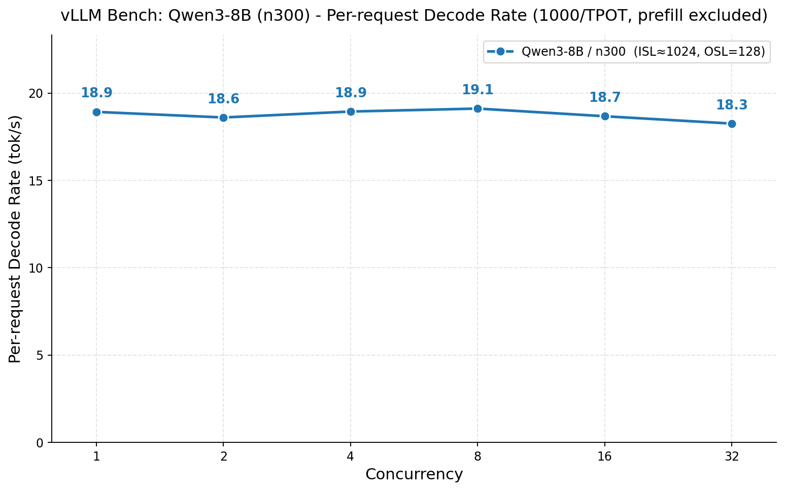
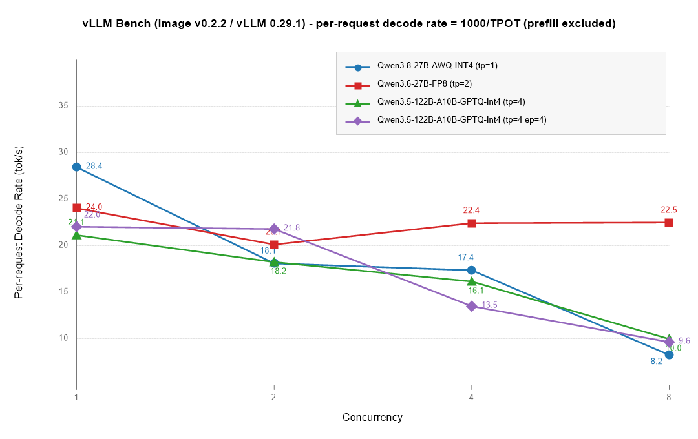

# RVOCs 发布说明

## v1.0.1 · 2026-11-10

编排层 `rvocs-main` v1.0.1：CLI 精简后的首个对外版本。

- 新增 `--list-releases`（按 target + 架构列出已发布产物）与 `--clone`（显式获取厂商仓库）；
- 移除 `--status` / `--verify` / `--bom` / `--sync` / `--dry-run` / `--yes` / `--no-clone`，
  `--deploy` 暂不开放（容器启动见厂商仓库 README 的 `docker run` 示例）；
- 发布产物集中到 `RELEASES.list` 维护，`--download` 与内部部署 helper 共用同一份清单。

### 1. 产物总览

| # | 产物 | target | 平台 | 上游基线 |
|---|---|---|---|---|
| 1 | `rvocs-tt-deps_v0.1.0_amd64.deb` | `tt-host` | x86_64 宿主机 | tt-kmd 2.11.0 / tt-umd 0.9.14（见 2.1） |
| 2 | `rvocs-vllm-tt-amd64:v0.1.0` | `tt-stack` | x86_64 + Wormhole / Blackhole | TT-Metal v0.79.0-rc11（见 2.2） |
| 3 | `rvocs-vllm-therock10.0-r9700-riscv64:v0.2.2` | `therock` | riscv64 + R9700（gfx1201） | ROCm 10.0.0（见 2.3） |

- 镜像：`swr.cn-east-3.myhuaweicloud.com/cloud-mdgx/<artifact>`（华为云 SWR 公共命名空间）；
- `.deb`：GitHub Releases，`RVOCs-org/rvocs-hcs-tenstorrent` 的 `v0.1.0` 标签。

### 2. 产物明细

#### 2.1 `rvocs-tt-deps_v0.1.0_amd64.deb` — 宿主机依赖

- 内容：tt-kmd 内核驱动（DKMS 或预编译）、tt-smi / tt-flash / tt-topology（系统级安装，不建 venv）、
  持久化 1G hugepages、udev 规则；
- 适用：Debian / Ubuntu x86_64 宿主机；与发行版自带的 `tt-smi` / `tt-flash` / `tt-topology` 冲突（`Conflicts:`）。

```bash
./rvocs.sh --target tt-host --arch x86 --download   # -> work/packages/rvocs-tt-deps_v0.1.0_amd64.deb
./rvocs.sh --target tt-host --arch x86 --install
```

内部组件的上游代码版本（`tag/ref @ commit`）：

| 组件 | tag / ref | commit | 作用 |
|---|---|---|---|
| tt-kmd | `ttkmd-2.11.0` | `c05f2246` | 内核驱动（DKMS），提供 `/dev/tenstorrent` |
| tt-umd | `v0.9.14` | `5ad28496` | 用户态驱动与 nanobind 绑定（按工具元数据自动对齐） |
| tt-smi | `v6.8.0` | `e25a4652` | 设备状态与工具链 |
| tt-flash | `v4.1.0` | `8c749673` | 固件烧写 |
| tt-topology | `v1.2.20` | `7bd675f8` | 拓扑配置 |

> 包内 `VERSION` 与 `bundle.version` 为 `0.1.1`，控制信息 `Version: 0.1.1`；发布资产按 release tag `v0.1.0` 命名。

#### 2.2 `rvocs-vllm-tt-amd64:v0.1.0` — Tenstorrent 推理镜像

- 平台：x86_64 宿主 + Wormhole / Blackhole 系列（n300 等）；
- 基础镜像：`ghcr.io/tenstorrent/tt-inference-server/vllm-tt-metal-src-dev-ubuntu-22.04-amd64:0.22.0-v0.79.0-rc11-d84049e`
  （上游 Dockerfile 路径，`fetch → image → verify`）。

```bash
./rvocs.sh --target tt-stack --arch x86 --download   # -> rvocs-vllm-tt-amd64:v0.1.0
```

上游组件：

| 组件 | tag / ref | commit | 说明 |
|---|---|---|---|
| tt-metal | `v0.79.0-rc11` | `29f93c91` | TT-Metalium / TT-NN 核心 |
| tt-inference-server | commit（原 `v0.22.0` 标签已指向别处） | `0da24a9d` | 官方 Dockerfile、入口与 model_spec |
| vllm-tt-plugin | `d84049e`（main） | `d84049ed` | vLLM 平台插件（内部 pin `vllm==0.30.0`） |
| sfpi | commit（`7.78.0` 标签已指向别处） | `fe971db5` | riscv-tt-elf 交叉工具链源码 |
| tt-smi（镜像内） | `v3.1.1` | `a2791bfe` | 独立 venv 中的设备工具 |

测试数据：



#### 2.3 `rvocs-vllm-therock10.0-r9700-riscv64:v0.2.2` — AMD 推理镜像

- 平台：riscv64 宿主（内核 ≥ `7.0.0-31-generic`）+ Radeon AI PRO R9700（gfx1201 / gfx120X-all）；
- 镜像内提供 ROCm 用户态、torch / torchvision / triton / vLLM 与 `vllm serve` 入口；
- 宿主侧只需 amdgpu 驱动与 `/dev/kfd`、`/dev/dri`。

```bash
./rvocs.sh --target therock --arch riscv --download   # -> rvocs-vllm-therock10.0-r9700-riscv64:v0.2.2
```

上游组件：

| 组件 | tag / ref | commit | 说明 |
|---|---|---|---|
| TheRock | `therock-10.0` | `16adc4d8` | ROCm 超级工程（组件由上游统一 pin） |
| ROCm | `10.0.0`（stable） | — | 由 TheRock 构建，含 RCCL / NCCL |
| PyTorch | `release/2.13`（`2.13.0a0`） | `cf30153c` | ROCm/HIP 后端 |
| torchvision | `v0.28.0` | — | 与 PyTorch 2.13 配套 |
| Triton | `v3.7.0` | `5f3f125e` | |
| vLLM | `v0.29.0` | `98dff2a8` | 镜像内 wheel 自报 `0.29.1.dev0+g98dff2a81` |
| RCCL / NCCL | ROCm 10.0.0 内置 | — | 未单独 pin |

测试数据：



测试环境：Radeon AI PRO R9700（按 tp / ep 配置）、ROCm 10.0.0、镜像内 vLLM 0.29.1（wheel 版本）。

### 3. 支持范围与已知限制

| 项 | 状态 |
|---|---|
| 宿主架构 | riscv64 / x86_64（aarch64 未纳入支持范围） |
| `tt-host` | x86_64 已发布 `.deb`；riscv64 交付包暂未发布 |
| `tt-stack` | x86_64 已发布镜像；riscv64 镜像暂未发布 |
| `therock` | riscv64 已发布镜像；x86_64 待支持 |
| `--deploy` | 暂未开放，按厂商仓库 README 的 `docker run` 示例启动 |
| 多卡 / 大模型 | tp=2 / tp=4 数据见上；更大规模组合仍在推进 |

### 4. 校验方式

```bash
./rvocs.sh --list-releases                              # 确认产物与版本
./rvocs.sh --target tt-host --arch x86 --download       # 宿主机包
./rvocs.sh --target tt-stack --arch x86 --download      # Tenstorrent 镜像
./rvocs.sh --target therock --arch riscv --download     # AMD 镜像
```

`--download` 拉镜像后只保留本地短名（registry 前缀的 tag 会被删除），`docker images` 中每个镜像只有一条记录。
